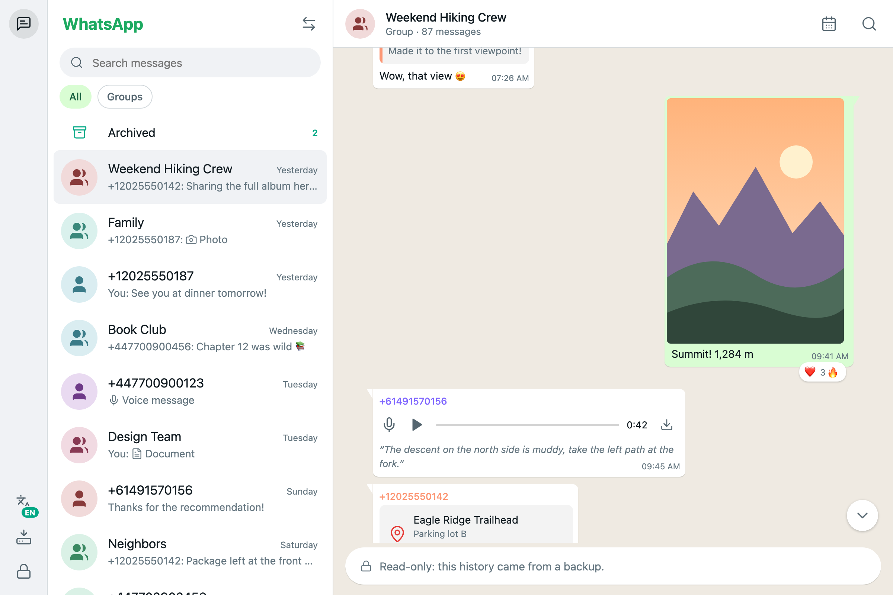
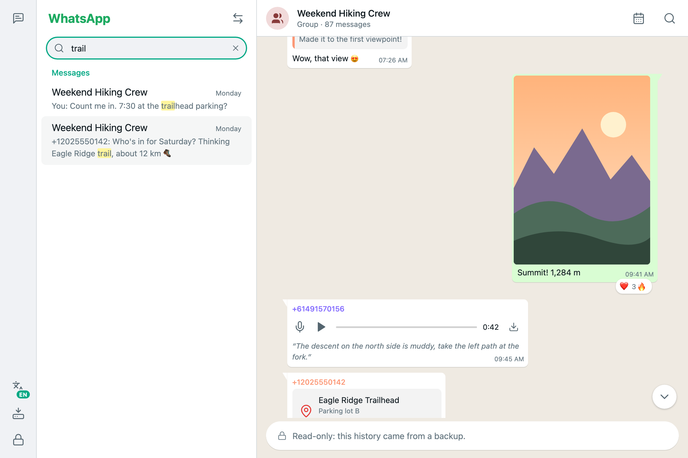
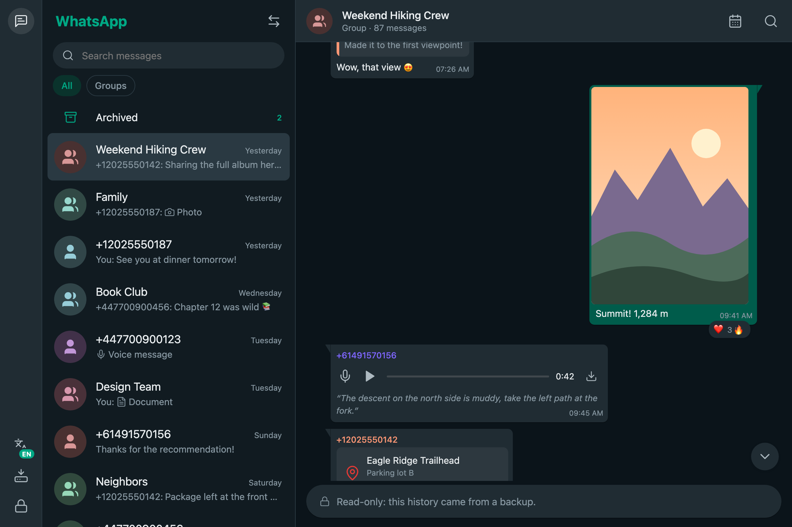
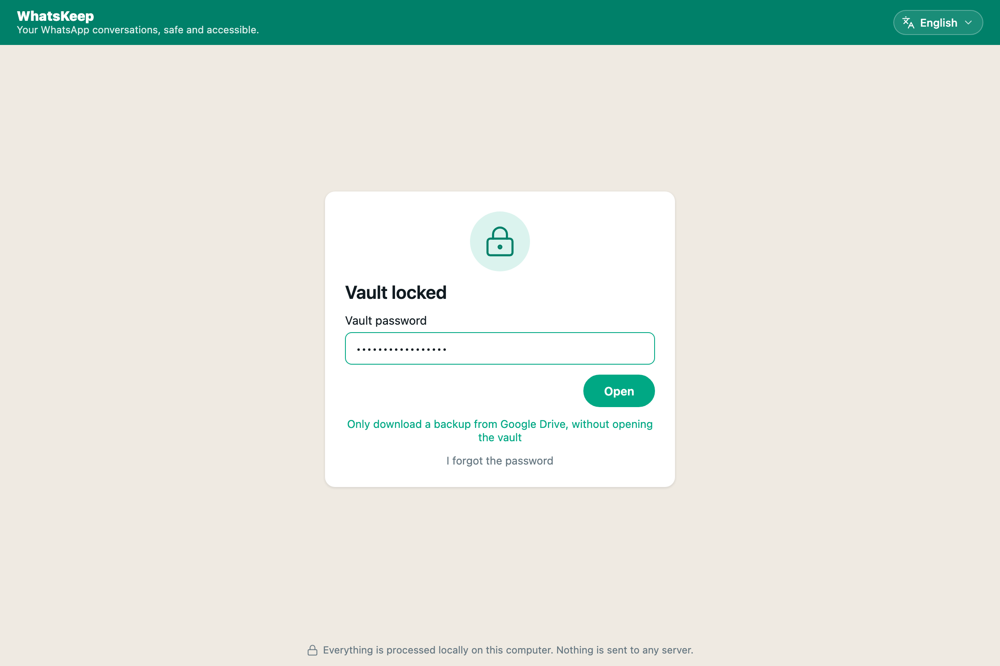
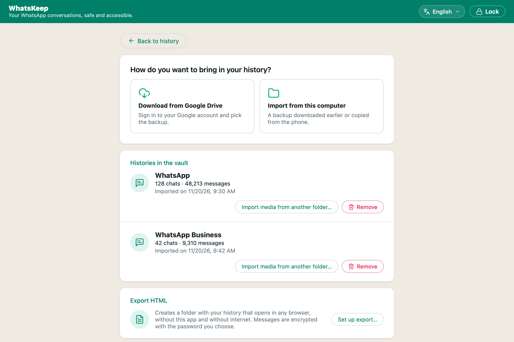

# WhatsKeep

**Your WhatsApp conversations, safe and accessible.**

*Versão em português no [final deste arquivo](#português).*

WhatsKeep opens your WhatsApp and WhatsApp Business backups on your computer, so you can read and search all your chats — with photos, videos and voice messages — in a familiar WhatsApp-like window. Everything happens on your computer: your history is kept in an encrypted vault, protected by a password only you know, and nothing is sent to any server.

<picture>
  <source media="(prefers-color-scheme: dark)" srcset="docs/screenshots/chat-dark.png">
  
</picture>

- **For everyone:** [Screenshots](#screenshots) · [Download](#download) · [Before you start](#before-you-start-get-your-backup-key) · [How to use](#how-to-use) · [Questions and problems](#questions-and-problems)
- **For advanced users:** [Supported backups](#supported-backups) · [Where your data is](#where-your-data-is) · [Diagnostics log](#diagnostics-log)
- **For developers:** [Build from source](#build-from-source) · [Project layout](#project-layout) · [Documentation](#documentation)

---

## Screenshots

| | |
|---|---|
|  |  |
| **Search** every message, accents and case ignored, and jump to the result. | **Light and dark mode**, following your system. |
|  |  |
| **Encrypted vault:** your password opens it; it locks itself when you step away. | **Import** from Google Drive or from a file, plus photos and videos from your phone. |

All screenshots use made-up chats and fictional phone numbers.

## Download

| System | Status |
|---|---|
| macOS (Apple Silicon and Intel) | Supported and tested |
| Windows, Linux | Should build, not tested yet |

Get the latest version from the **[Releases page](../../releases/latest)**, under *Assets*:

- **Apple Silicon (M1 and later):** `WhatsKeep_<version>_aarch64.dmg`
- **Intel Macs:** `WhatsKeep_<version>_x64.dmg`

Not sure which Mac you have? Apple menu → **About This Mac**: "Chip Apple M…" is Apple Silicon, "Processor Intel…" is Intel. If no release is listed yet, [build it from source](#build-from-source) (about 10 minutes, same installer).

Installing on macOS:

1. Open the `.dmg` and drag **WhatsKeep** to **Applications**.
2. The first time, macOS may say it cannot verify the app (it is not signed with an Apple Developer certificate yet). Open **System Settings → Privacy & Security**, scroll down and click **Open Anyway** next to WhatsKeep. You only need to do this once.

## Before you start: get your backup key

WhatsApp backups are encrypted. WhatsKeep needs the key to open them, and the easiest way to have one is the **64-digit key**:

1. On your phone, open WhatsApp → **Settings → Chats → Chat backup → End-to-end encrypted backup → Turn on**.
2. Choose **Use 64-digit encryption key instead** (not a password) and write the key down somewhere safe.
3. Tap **Back up** and wait until it finishes uploading.
4. Using WhatsApp Business too? Do the same there — it has its own key.

> A backup protected **only by a password** cannot be opened outside WhatsApp: that key is kept on WhatsApp's servers. Switch to the 64-digit key as above.

## How to use

1. **Choose where your history comes from:** Google Drive or a backup on your computer. The first time you import, WhatsKeep asks you to create the vault password (at least 8 characters; a long phrase is best). **There is no way to recover it** — if you forget it, you will need to import your backups again. Only saving a Drive backup to a folder needs no password.
2. **Import your history**, either:
   - **From Google Drive:** type the e-mail of the Google account with the backup and click **Sign in to Google**. A Google window opens with your e-mail filled in; sign in and accept. Pick the backup and what to do with it: **import into the vault** (nothing saved elsewhere), **save a copy to a folder and import** (e.g. on an external drive, to import again later without Google), or **only save a copy to a folder**. Importing needs the 64-digit key. The messages are available as soon as they are imported; photos, videos and audio keep going in the background. If it stops (Google access lasts about an hour), sign in again (and choose the same folder): it picks up where it left off.
   - **From a file:** copy `msgstore.db.crypt15` from your phone (it is in `Android/media/com.whatsapp/WhatsApp/Databases`), or take it from a backup folder saved from Google Drive, choose it in WhatsKeep and enter the key. In a backup folder, the photos and videos next to it can come in at the same time.
3. **Photos and videos from your phone:** copy the phone's whole `WhatsApp` folder to your computer and, in **Import from this computer**, choose the `msgstore.db.crypt15` inside it: the media next to it come in too. If the media are in a separate folder, use **Import media from another folder…** in the list of histories. Only files used by your chats are kept.
4. **Read and search.** Browse chats, search all messages, jump to a date, open photos and videos.
5. **Export (optional):** create a folder that opens offline in any browser, protected by a password — all chats, some chats, or a different password for each chat. Handy to share a single conversation with someone.

WhatsKeep locks itself after 5 minutes without use. Forgot the password? On the lock screen, **I forgot the password** deletes the vault so you can start over (your backups are not touched); with the vault open, you can also remove one history or delete the whole vault from the import screen. Switch the language (English / Português) in the top bar or in the side bar.

## Questions and problems

- **Google says "This browser or app may not be secure".** Use the link below the sign-in button, *Sign in through the browser (manual sign-in)*, and follow the steps.
- **"The key does not open this backup".** Check that the key belongs to this account and app (WhatsApp and WhatsApp Business have different keys) and that the backup was made after you turned on the 64-digit key.
- **My backup is not end-to-end encrypted.** Its key is stored inside the phone and can only be copied from a rooted phone. Turn on the 64-digit key (see above) and make a new backup.
- **I forgot the vault password.** It cannot be recovered. Delete the vault folder (see [Where your data is](#where-your-data-is)) and import again.
- **macOS says the app "is damaged and can't be opened".** That is how macOS sometimes reports an app downloaded from the internet that is not signed by Apple. Run `xattr -dr com.apple.quarantine /Applications/WhatsKeep.app` in Terminal and open it again.
- **Is my data sent anywhere?** No. The only connections are to Google, when you choose to download a backup from Google Drive. See [SECURITY.md](SECURITY.md).

---

## Supported backups

| Backup | What you need | Supported |
|---|---|---|
| End-to-end encrypted with a 64-digit key (`.crypt15`) | the 64 digits, or the `encrypted_backup.key` file | ✅ |
| Not end-to-end encrypted (`.crypt14`) | the phone's `key` file (requires root) | ✅ |
| End-to-end encrypted with a password only | the key is kept by WhatsApp's servers | ❌ |

Both the modern and the legacy WhatsApp database layouts are supported. Message types WhatsKeep does not know yet are listed in the import summary.

## Where your data is

- **Vault (macOS):** `~/Library/Application Support/com.whatskeep.desktop/vault/` — one encrypted database per app (WhatsApp, WhatsApp Business) and one encrypted file per photo/video. The password unwraps the vault key (Argon2id + AES-256-GCM); there is no recovery.
- **Settings:** `settings.json` next to the vault (only the interface language).
- **Never on disk in plain form:** messages, media, keys, Google tokens. The vault is excluded from Time Machine and Spotlight.
- **Google Drive access** is unofficial (it uses the same path as WhatsApp on Android), lives only in memory for up to 50 minutes, and may stop working if Google changes it; importing from a file always works.

Formats and key hierarchy: [docs/ARCHITECTURE.md](docs/ARCHITECTURE.md). Threat model and limitations: [SECURITY.md](SECURITY.md).

## Diagnostics log

Useful when something fails with a real backup. It never contains message text, phone numbers, names, passwords, keys, tokens or e-mail — only steps, timings, sizes, counts and error codes. Requests to Google are logged with secrets redacted.

```sh
WK_LOG=debug "$(ls -d /Applications/WhatsKeep.app/Contents/MacOS/* | head -1)"   # installed app, log in the terminal
pnpm dev:log                                                                   # from source; saves to logs/
```

---

## Build from source

Requirements: macOS with the Xcode Command Line Tools (`xcode-select --install`), [Rust](https://rustup.rs) (latest stable), Node.js 20.19+ or 22.12+ and pnpm 10 (`corepack enable`).

```sh
git clone <repository-url> whatskeep && cd whatskeep
pnpm install
pnpm build            # installer in target/release/bundle/ (dmg/ and macos/)
pnpm dev              # or run it in development mode
```

Checks:

```sh
cargo test --workspace   # Rust tests (crypto, vault, import, Google flow against a mock, ACL, export)
cargo clippy --workspace --all-targets
pnpm lint:security       # forbidden frontend patterns
pnpm test:e2e            # opens real exports in Chromium and WebKit via file://
pnpm screenshots         # regenerates docs/screenshots/ from the real UI with made-up data
```

## Project layout

```
apps/desktop/           Tauri v2 app (React in src/, Rust in src-tauri/)
crates/wk-crypt/        crypt14/crypt15 and .mcrypt1 decryption (no I/O)
crates/wk-import/       WhatsApp database → WhatsKeep's schema, with full-text search
crates/wk-vault/        Encrypted vault (SQLCipher, Argon2id) and viewer queries
crates/wk-gdrive/       Google sign-in and Google Drive backup download
crates/wk-export/       Encrypted offline HTML export
packages/viewer/        Shared WhatsApp-style viewer (React)
packages/export-shell/  The export's single-file index.html
```

## Documentation

- [AGENTS.md](AGENTS.md) — conventions, security rules and pitfalls (for contributors and AI agents).
- [docs/ARCHITECTURE.md](docs/ARCHITECTURE.md) — data flow, key hierarchy, on-disk and export formats.
- [docs/RECIPES.md](docs/RECIPES.md) — step-by-step guides for common changes.
- [docs/DEVELOPMENT.md](docs/DEVELOPMENT.md) — test fixtures, end-to-end tests and the diagnostics log.
- [docs/RELEASING.md](docs/RELEASING.md) — CI, automatic releases on GitHub and optional code signing.
- [SECURITY.md](SECURITY.md) — threat model, protections and limitations.

---

## Português

**Suas conversas do WhatsApp, seguras e acessíveis.**

O WhatsKeep abre os backups do WhatsApp e do WhatsApp Business no seu computador, para você ler e pesquisar todas as conversas — com fotos, vídeos e áudios — numa janela parecida com a do WhatsApp. Tudo acontece no seu computador: o histórico fica num cofre cifrado, protegido por uma senha que só você sabe, e nada é enviado para servidores.

Veja as telas do app em [Screenshots](#screenshots) (a interface também está em português).

### Baixar

Funciona no macOS (Apple Silicon e Intel); Windows e Linux ainda não foram testados. Baixe a versão mais recente na **[página de Releases](../../releases/latest)**, em *Assets*:

- **Apple Silicon (M1 ou mais novo):** `WhatsKeep_<versão>_aarch64.dmg`
- **Macs Intel:** `WhatsKeep_<versão>_x64.dmg`

Não sabe qual é o seu Mac? Menu Apple → **Sobre Este Mac**: "Chip Apple M…" é Apple Silicon, "Processador Intel…" é Intel. Se ainda não houver nenhuma versão publicada, gere a sua seguindo [Build from source](#build-from-source) (cerca de 10 minutos).

Para instalar, abra o `.dmg` e arraste o **WhatsKeep** para **Aplicativos**. Na primeira vez, o macOS pode dizer que não consegue verificar o app (ele ainda não é assinado com certificado da Apple): abra **Ajustes do Sistema → Privacidade e Segurança**, role a tela e clique em **Abrir Mesmo Assim** ao lado do WhatsKeep. Se o macOS disser que o app "está danificado", rode `xattr -dr com.apple.quarantine /Applications/WhatsKeep.app` no Terminal e abra de novo.

### Antes de começar: a chave do backup

1. No celular, abra o WhatsApp → **Configurações → Conversas → Backup de conversas → Backup criptografado de ponta a ponta → Ativar**.
2. Escolha **Usar chave de criptografia de 64 dígitos** (não a senha) e anote a chave num lugar seguro.
3. Toque em **Fazer backup** e espere terminar de enviar.
4. Usa também o WhatsApp Business? Faça o mesmo nele — a chave é outra.

Backups protegidos **só por senha** não podem ser abertos fora do WhatsApp, porque essa chave fica nos servidores do WhatsApp.

### Como usar

1. **Escolha de onde vem o histórico:** Google Drive ou um backup no computador. Na primeira importação, o WhatsKeep pede para criar a senha do cofre (mínimo de 8 caracteres; uma frase longa é o ideal). **Não existe recuperação**: se esquecer, será preciso importar os backups de novo. Só salvar um backup do Drive numa pasta não pede senha.
2. **Importe o histórico:**
   - **Pelo Google Drive:** digite o e-mail da conta Google do backup e clique em **Entrar no Google**. Na janela do Google (com o e-mail já preenchido), entre e aceite. Escolha o backup e o que fazer com ele: **importar para o cofre** (nada fica salvo fora dele), **salvar uma cópia numa pasta e importar** (por exemplo num HD externo, para importar de novo depois sem o Google) ou **só salvar uma cópia numa pasta**. Importar exige a chave de 64 dígitos. As mensagens ficam disponíveis assim que são importadas; fotos, vídeos e áudios continuam em segundo plano. Se parar (o acesso ao Google dura cerca de 1 hora), entre de novo (e escolha a mesma pasta): ele continua de onde parou.
   - **Por arquivo:** copie o `msgstore.db.crypt15` do celular (fica em `Android/media/com.whatsapp/WhatsApp/Databases`), ou use o de uma pasta de backup salva do Google Drive, escolha o arquivo no WhatsKeep e digite a chave. Numa pasta de backup, as fotos e vídeos ao lado entram junto.
3. **Fotos e vídeos do celular:** copie a pasta `WhatsApp` inteira do celular para o computador e, em **Importar do computador**, escolha o `msgstore.db.crypt15` de dentro dela: as mídias ao lado entram junto. Se as mídias estiverem numa pasta separada, use **Importar mídias de outra pasta…** na lista de históricos. Só entram os arquivos usados nas conversas.
4. **Leia e pesquise:** navegue pelas conversas, pesquise em todas as mensagens, pule para uma data, abra fotos e vídeos.
5. **Exporte (opcional):** gere uma pasta que abre offline em qualquer navegador, protegida por senha — todas as conversas, só algumas ou uma senha diferente por conversa.

O WhatsKeep trava sozinho após 5 minutos sem uso. Esqueceu a senha? Na tela do cofre travado, **Esqueci a senha** apaga o cofre para você começar de novo (os seus backups não são apagados); com o cofre aberto, dá para remover um histórico ou apagar o cofre inteiro na tela de importação. O idioma (Português / English) se troca na barra superior ou na barra lateral.

### Dúvidas e problemas

- **O Google diz "Esse navegador ou app pode não ser seguro".** Use o link abaixo do botão de entrar, *Entrar pelo navegador (login manual)*, e siga os passos.
- **"A chave não abre este backup".** Confira se a chave é desta conta e deste app (WhatsApp e WhatsApp Business têm chaves diferentes) e se o backup foi feito depois de ativar a chave de 64 dígitos.
- **Meu backup não tem criptografia de ponta a ponta.** A chave dele fica dentro do celular e só pode ser copiada com root. Ative a chave de 64 dígitos e faça um backup novo.
- **Esqueci a senha do cofre.** Não há como recuperar. Apague a pasta do cofre (`~/Library/Application Support/com.whatskeep.desktop/vault/`) e importe de novo.
- **Meus dados vão para algum lugar?** Não. A única conexão é com o Google, quando você escolhe baixar um backup do Google Drive. Veja o [SECURITY.md](SECURITY.md).

Informações para usuários avançados e desenvolvedores estão nas seções em inglês acima.
